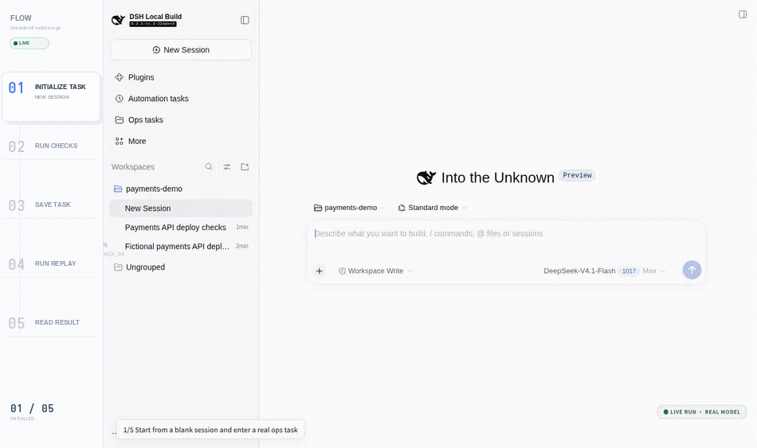

# MaintainAll

`@royenheart/dsh-plugin-maintainall` is a DeepSeek Harness (dsh) plugin that turns a successful ops session into a reusable task asset and replays it into a new session when a deterministic trigger fires.

- Architecture and persisted-state model: [docs/architecture.md](docs/architecture.md)
- Development, build, and profile install: [docs/development.md](docs/development.md)
- Testing policy and current gaps: [docs/testing.md](docs/testing.md)
- Development map: [.agents/skills/maintainall/SKILL.md](.agents/skills/maintainall/SKILL.md)
- Decision records: [.agents/skills/maintainall/decisions/README.md](.agents/skills/maintainall/decisions/README.md)

## What it does

1. Run an ops task once in a normal dsh session.
2. Save the session as a task asset: `AGENTS.md`, skills, scripts, a replay seed, and trigger declarations.
3. When a trigger fires (schedule, file change, Docker event, journald, webhook, or command transition), create a new session from the seed and inject the trigger context.

Trigger decisions are deterministic: source filter, optional CEL `when`, debounce/rate limit, then dispatch. The model never participates in the trigger decision.


## Demo



A live product demo recorded from a scratch DSH instance with the real model, in the English light theme. A vertical chapter-index rail stays on the left while the live DSH UI remains on the right: initialize, run checks, save task, replay, result. The recording types the task fields at a readable pace, then enters the replay session immediately after Run once and follows it to `DEPLOY_CHECK_OK`.

The chapter rail is a recording overlay, not product chrome. The visible replay run is `20261028-030658-cf17aabf` from task `payments-deploy-light2` on code commit `5ea65f1`.

## Install

```sh
npm install
npm run build
dsh plugin --profile <profile> add link:<checkout>
```

Restart dsh for host changes. The plugin's data root is `$DSH_HOME/@royenheart/dsh-plugin-maintainall`; see [docs/architecture.md](docs/architecture.md#persisted-state).
