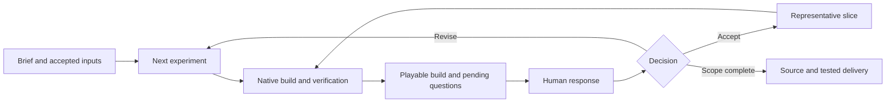

# Native game creation and workflow design

The Art Creation bundle supports native game prototyping through sketches, playable experiments, and short player responses. [The skill entry](../SKILL.md) routes game requests through [progressive game creation](../references/game-creation.md) to [native engine construction](../methods/game-engine/SKILL.md). The first playable prototype and subsequent builds share an engine project. Browser feedback can use a compatible Web export or streamed native execution; [preview route selection](../methods/game-engine/references/remote-preview.md) preserves the game's required runtime features.

The entry point requires [feedback setup](../references/feedback-setup.md) once the current intent and next decision are clear enough. This shared step selects a representation, reuses or prepares its runtime, verifies a small visible/playable result, and establishes a version-linked response channel before substantial construction. It applies across static art, animation, 3D and games, with only the selected backend's details loaded. The setup can grow with the project; an existing working path already satisfies the prerequisite. The creative loop continues through atomic decomposition, meaningful alternatives, short human responses, retained decisions, and progressive refinement using that prepared path.

## Current implementation

| Layer | Available capability | Scope |
|---|---|---|
| Creative guidance | Player intent, atomic hypotheses, native alternatives, short feedback, accepted decisions | Progressive disclosure inside Art Creation |
| Godot helper | Initialize, check, export, and serve a native project; inspect installed engine/templates | Python standard library; an installed Godot binary is required |
| Native starter | A room with collisions, collect/exit rules, two movement profiles, and native feedback controls | An editable demonstration of play and feedback |
| Delivery | Web and Linux export presets; file-hash manifests; optional HTTPS and isolation headers | The same editable GDScript project |
| Native streaming | Selkies session setup and verification, with noVNC and Sunshine/Moonlight alternatives | An external application session; deployment configuration stays beside the local project |
| Workflow enforcement | State, transition and framework research | Design proposal for a future application layer |

Use the commands in [Godot execution](../methods/game-engine/references/godot.md). Export directories are separate from source projects and previous builds. Each export records file hashes; the starter records project version, question version, session/run, movement parameters, and answers. Update the project version for each tested revision, and keep its manifest and source revision beside the feedback. Reactions remain in memory until exported: Web execution downloads JSON to the client, while native execution writes JSON to Godot's user-data directory. Persist that directory for a streamed application.

Godot 4.7.2 with matching official templates is the tested environment. The sample uses GDScript, the Compatibility renderer, and a single-threaded Web build. The actual 4.7.2 loader requires a secure context even for this single-threaded configuration: use HTTPS trusted by the client, or SSH forwarding to localhost. Threaded builds additionally require cross-origin isolation. The exported game runs on the user's device. Consult the [official Web documentation](https://docs.godotengine.org/en/stable/tutorials/export/exporting_for_web.html) and [CLI documentation](https://docs.godotengine.org/en/stable/tutorials/editor/command_line_tutorial.html) for target compatibility and export options.

[Selkies streaming](../methods/game-engine/references/selkies.md) provides another verified feedback route. The local validation uses Selkies 2.1.0, a dedicated X11 session, a mounted native project, persistent Godot user data, and an authenticated WebSocket stream behind HTTPS or forwarded localhost. The engine runs on the server, with hardware OpenGL rendering and VAAPI H.264 encoding observed in this deployment. Browser clients receive the application stream without loading a Godot Web game build. The image digest, host configuration, credentials and runtime evidence are stored outside the repository.

## Research and adopted practices

Research date: 2026-10-26. Public product claims, inspected behavior, and proposed design are distinguished below.

### AutoBulider / Fangkuai Jinggou

[AutoBulider](https://autobulider.cn) presents a Minecraft construction service. Its public interface describes reference-image and brief input, parameter interpretation, multi-angle previews, and native Minecraft delivery. The public frontend exposes a staged interaction with editable prompt optimization, versioned orders, stage feedback, and revision input. Its client-side stage descriptions include planning, layout/foundation, structure, roof, facade, decoration, and landscape, as well as construction checks and visual inspection. This review covers the public frontend; backend orchestration and the login-gated generation flow remain unverified.

Public inspection sources: [application script](https://autobulider.cn/app.js?v=20261025-order-poll-1) and [stage-display script](https://autobulider.cn/architects.js?v=20261020-epic-volume). The local starter and helper are original implementations.

| Visible practice | Transfer to game creation |
|---|---|
| Choose constraints before generation and inspect the interpreted request | Keep a brief and editable assumptions; surface the unresolved game experience |
| Stage construction around the target artifact | Build and iterate native engine scenes and resources |
| Present actual previews with versions | Ask about the precise playable build/profile the user experienced |
| Feed inspection and user response back into construction | Revise the existing project while retaining accepted decisions |
| Display stage progress | Drive progress from actual jobs, artifacts and pending questions |

The proposed game workflow adopts staged previews and adds explicit atomic questions and version-linked decision records. Framework selection is a separate design decision described below.

### Game design and prototyping

The original [MDA framework](https://users.cs.northwestern.edu/~hunicke/MDA.pdf) connects mechanics, the dynamics they produce during play, and the player's experience. This supports reasoning from an intended feeling to observable behavior and then to controllable rules.

[Unity's prototyping curriculum](https://learn.unity.com/project/creative-core-prototyping) and [game designer playbook](https://unity.com/resources/game-designer-playbook) support focused playable experiments. Fidelity should match the question: movement needs controls and collision; an atmosphere question may need enough sound, lighting and imagery for a meaningful judgment.

[Machinations' framework](https://machinations.io/docs/framework-basics) models resource sources, pools, drains and converters. These concepts provide useful atoms for progression and economy, alongside spatial, temporal, perceptual and preference atoms elsewhere in a game.

The resulting loop is `intent → hypothesis → native experiment → play observation + human response → retained decision → next experiment`. A representative playable slice follows once the central experience is understood. Use the [game dimension table](../references/game-creation.md#atomic-game-dimensions) to select the relevant questions.

## Future enforced workflow

The skill describes how to work. A runtime would control task dispatch, accepted state, and transitions. A worker can propose an action; application code checks that the required evidence exists before adopting the result. Request human decisions for unresolved creative choices and automate routine build and tool operations.

| Transition | Data required by the application |
|---|---|
| Brief to experiment | Intended player action/experience, target assumptions, next uncertainty, retained decisions |
| Experiment to construction | Hypothesis, changed properties, source revision and a short play scenario |
| Construction to playable review | Native artifact identity, export target, startup and interaction evidence, unresolved checks |
| Feedback to revision or acceptance | Question ID/version, build/profile identity, workflow revision, human response or explicitly recorded unknown |
| Acceptance to delivery | Requested scope satisfied, editable source, tested build and reproducible commands |

An answer event can contain `workflow_id`, `workflow_revision`, `build_id`, `question_id`, `question_version`, `response`, and `evidence_ref`. A measurement can contain `atom_id`, `object/state`, `method`, `value`, `unit`, `conditions`, and `artifact_ref`. Store preference answers separately from measured facts. A changed dependency can reopen a decision; an answer to an older build is retained with its identity and explicitly reconciled before use.

### Framework comparison

| Option | Useful built-in mechanism | Work still owned by the application | Fit |
|---|---|---|---|
| Skill and ordinary agent loop | Contextual creative methods and flexible tool use | Durable state, guarded transitions, waiting, recovery, job identity | Current authoring workflow |
| [Temporal](https://docs.temporal.io/workflows) | Durable Workflow history, Activities, timers and message handling | Creative state model, transition validation, artifact storage, idempotent external effects, UI and worker limits | Long-running builds and human waits across process restarts |
| [LangGraph](https://docs.langchain.com/oss/python/langgraph/interrupts) | Graph state, interrupts, checkpoints and resume | Durable checkpointer setup, business gates, external job handling, artifact identity | A smaller conversational graph implementation |
| [XState](https://stately.ai/docs/persistence) | Explicit state machines, transitions and persisted snapshots | Storage integration, worker scheduling and recovery semantics | Interactive UI/application state |

Temporal is the leading candidate when enforced long-running creative projects become the primary requirement. Keep deterministic decisions in Workflows and put model calls, Godot/Blender processes and file operations in Activities. [Queries, Signals and Updates](https://docs.temporal.io/encyclopedia/workflow-message-passing) provide different read/input mechanisms; validated Updates can reject stale responses, while Signals need validation in the receiving application logic. Large projects and previews belong in an artifact store, referenced by immutable identity from workflow history.

Workflow replay reuses recorded Activity results; an Activity retry can repeat an external call. Define [retry policies](https://docs.temporal.io/encyclopedia/retry-policies), attempt identities and idempotent output adoption for engine jobs and model calls. Configure filesystem and process isolation in the worker's execution environment.

A first runtime should use one authoritative state owner and one worker adapter for local model tasks and engine jobs. An authenticated model CLI can run on that local worker. Add a web form for the pending atomic questions, an artifact store and a read-only status view. Validate restart recovery, stale/duplicate feedback, a failed build, cancellation, and retention of accepted decisions before expanding the workflow.

The runtime can make feedback readiness a prerequisite for substantial construction: record the selected authoring/viewing route, a small test artifact and observed conditions, and the response channel. Reuse this evidence while its assumptions hold; prepare additional capabilities when a changed decision requires them.

## Verification

Repository checks are `python3 skills/art-creation/scripts/check_index.py --json` and `python3 -m unittest discover -s tests/skills -p 'test_*.py' -v`. The existing skill CI discovers the new helper and language/index tests without model calls. These checks cover resource routing, native resource inventory, engine error handling, export isolation, output hashing, and actual HTTP MIME/isolation headers.

Runtime validation imports and starts a copied native project, exports Web and Linux builds, and plays the Web build in server-hosted Chromium with software rendering. The browser scenario compares movement profiles, verifies a collision, collects all objectives, reaches the exit, resets, answers native feedback controls, and downloads the corresponding JSON.

Native streaming validation observes decoded browser frames, drives movement and profile changes with browser input, operates the native feedback controls, and verifies the exported question/build/profile binding. A generated stereo tone reaches the browser's Web Audio path. Restart validation checks application autostart, reconnection and unchanged persisted feedback. Synthetic answers are archived separately from the live user response directory. These checks establish this delivery path; listening quality, network latency on the user's device, touch and gamepads remain target-device checks.
